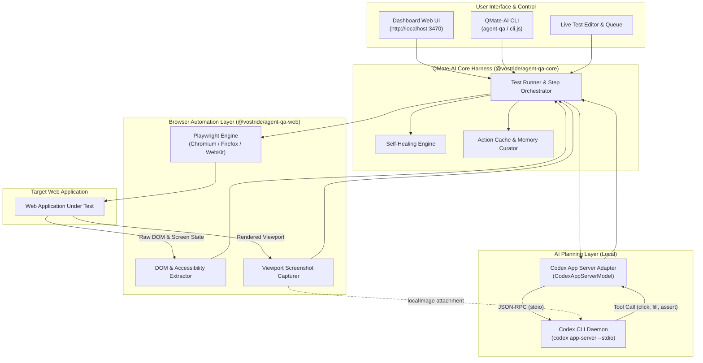

# QMate-AI (agent-qa)

> **The Self-Improving Agentic QA Harness with Memory & Self-Healing**  
> Powered locally by **Codex CLI (App Server)** and driven by **Playwright**.

Write tests in natural language for web applications. QMate-AI uses your locally authenticated **Codex CLI** to observe screenshots and DOM hierarchies, plan actions, adapt to UI changes with self-healing, and continuously learn from past runs—all without requiring external cloud LLM API keys.

---

## 🌟 Key Features

- **Natural Language Testing**: Define test workflows and assertions in declarative YAML using plain human language.
- **Codex CLI App Server Brain**: Uses your local `codex app-server --stdio` JSON-RPC connection as the test planner. No API keys or external subscriptions needed.
- **Playwright-Powered Execution**: Browser automation is strictly executed via [Playwright](file:///c:/Users/rohan/Documents/Gen%20QE%20Toolkit/QMate-AI/packages/web) (`@vostride/agent-qa-web`), supporting Chromium, Firefox, and WebKit with native clicks, fills, smart waits, and viewport control.
- **Self-Healing Test Execution**: When a locator, button, or interaction fails due to UI drift, QMate-AI re-inspects the screen state, formulates alternate recovery paths, and heals the step in-flight.
- **Persistent Execution Memory**: Records observations from past passes and healed runs, curating context to make future executions faster and more resilient.
- **Smart Action Cache**: Caches validated plan sequences across identical or similar steps to minimize latency and token overhead.
- **Web Dashboard & Live Editor**: Full React-based dashboard UI for managing test suites, inspecting step-by-step screenshots and timeline videos, editing configs, and running live browser sessions.
- **Docker Lifecycle Hooks**: Run sandboxed Node, Bun, Python, or Bash containers before/after tests to seed test fixtures, mock APIs, or reset state.

---

## 🏗️ Architecture



### Division of Responsibilities

1. **Codex CLI App Server (The Brain)**:
   - Receives the step goal, accessibility DOM snapshot, and screenshot image.
   - Evaluates the current page state, determines the required user interaction, and outputs structured action tool calls (`click`, `fill`, `assert`, `navigate`, `scroll`).
   - Powers the self-healing recovery loop when a step encounters unexpected UI changes.

2. **Playwright (The Execution Engine)**:
   - Launches and manages the browser instance.
   - Captures high-resolution screenshots and DOM accessibility trees.
   - Executes the physical user actions returned by Codex CLI with smart auto-waiting and action validation.

---

## 📋 Prerequisites

Before setting up QMate-AI, ensure the following are installed:

- **Node.js**: Version `>= 24.0.0`
- **pnpm**: Version `>= 10.6.1` (on Windows, invoke via `pnpm.cmd`)
- **Codex CLI**: Installed and authenticated locally on your system (`codex.exe` in PATH). Verify with:
  ```powershell
  codex --version
  ```
- **Operating System**: Windows, macOS, or Linux.

---

## 🚀 Installation & Setup

### 1. Clone & Install Dependencies

From the project root:

```powershell
# Optional corporate proxy SSL workaround (if required)
npm config set strict-ssl false

# Install all monorepo dependencies
pnpm.cmd install
```

### 2. Build Monorepo Packages

Build the core packages, adapters, dashboard UI, and CLI in workspace dependency order:

```powershell
# Build all packages
pnpm.cmd build
```

*(Or build packages individually using `pnpm.cmd --filter @vostride/agent-qa-core build`, etc.)*

### 3. Install Playwright Browsers

Install Chromium browser binaries used by the Playwright engine:

```powershell
node packages/cli/dist/cli.js install-browsers --chromium
```

### 4. Initialize Project Configuration

In your test workspace (e.g., `demo-project/`):

Ensure `agent-qa.config.yaml` specifies `codex-app-server` as the active LLM:

```yaml
workspace:
  testMatch:
    - tests/web/**/*.yaml
  agentRules: ./agent-rules.md
  envFile: .env
  secretsFile: .env.secrets.local

services:
  cache:
    dir: .agent-qa/cache
    ttl: 7d
  accessibility:
    enabled: true
    standard: wcag2aa
    runAfter: every-step
  memory:
    dir: agent-qa-memory

registry:
  llms:
    - name: codex-app-server
      provider: codex-app-server
      model: gpt-5.6-luna

  targets:
    my-app:
      platform: web
      url: https://example.com

use:
  llm: codex-app-server
```

Create empty `.env` and `.env.secrets.local` files in the project directory if they do not exist:

```powershell
New-Item -ItemType File -Path demo-project/.env -Force
New-Item -ItemType File -Path demo-project/.env.secrets.local -Force
```

---

## 🩺 Environment Doctor Check

Run the diagnostics check to verify your Codex CLI integration, Playwright installation, and project configuration:

```powershell
cd demo-project
node ../packages/cli/dist/cli.js doctor
```

Expected output:
```
  agent-qa doctor

    Node.js            .................................... PASS
    Config file        .................................... PASS
    Config validation  .................................... PASS
    Secrets file       .................................... PASS
    LLM credential     .. credential optional (codex local) PASS
    LLM connection     ........... Testing without a credential PASS
    Playwright         .................................... PASS
    Test discovery     .................................... PASS

  All checks passed! Your environment is ready.
```

---

## 💻 Running QMate-AI

### 1. Launching the Web Application Dashboard

Launch the local web dashboard to run tests, inspect timeline logs, use the Live Editor, and manage configurations:

```powershell
cd demo-project
node ../packages/cli/dist/cli.js dashboard --open
```

- **Dashboard UI**: `http://localhost:3470` (or custom `--port <number>`)
- **MCP Server**: Automatically served on loopback at `http://127.0.0.1:3471/mcp`
- All interactions in the Live Editor and run queue automatically communicate with your local **Codex CLI App Server**.

### 2. Running Tests via CLI

Run a single test file in headless browser mode:

```powershell
cd demo-project
node ../packages/cli/dist/cli.js run tests/web/us-103.yaml
```

Run with verbose debug logs:

```powershell
node ../packages/cli/dist/cli.js --verbose run tests/web/us-103.yaml
```

Preview matching tests without executing:

```powershell
node ../packages/cli/dist/cli.js run tests/web/**/*.yaml --dry-run
```

---

## 📝 Writing Tests in Natural Language

Tests are authored in simple YAML files under `tests/web/`:

```yaml
test-id: t_login-validation-sample
name: Customer Login Flow
target: my-app
use:
  browser:
    name: chromium
    headless: true
    viewport:
      width: 1280
      height: 720
  cache: false

context: |
  Verify that users can log into their account with valid credentials.

steps:
  - Verify the page displays "Sign In"
  - Type "user@example.com" into the email input field
  - Type "Password123!" into the password input field
  - Click the "Sign In" button
  - Verify the user dashboard displays "Welcome back"
```

---

## 🧪 Testing and Verification

Run the test suites across packages:

```powershell
# Test core agent and Codex App Server integration
pnpm.cmd --filter @vostride/agent-qa-core test

# Test dashboard UI contracts
pnpm.cmd --filter @vostride/agent-qa-dashboard-ui test

# Test CLI commands and dashboard runner
pnpm.cmd --filter agent-qa test
```
